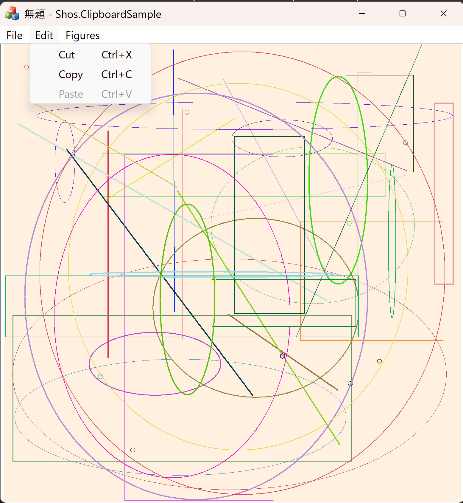

# [C++/MFC] Shos.ClipboardSample

English | [日本語](README.jp.md)

A small MFC (C++) sample that shows how to **copy figures to the Windows clipboard in several formats at once** and **paste them back** using an application-specific format.

The application is a simple figure editor. You can create random figures (dots, lines, rectangles and ellipses), select them with the mouse, and copy, cut or paste the whole drawing.



## What This Sample Demonstrates

| Topic | Description | Main source |
|---|---|---|
| Copying to the clipboard in multiple formats | One copy operation puts the same drawing on the clipboard as an **enhanced metafile**, a **bitmap (DIB)** and a **custom format**. Each target application picks the format it understands. | `ClipboardHelper.h` |
| Custom clipboard format | The document is serialized with `CArchive` into a format registered with `RegisterClipboardFormat("Shos.ClipboardSample.Figures")`, and restored from it on paste. | `ClipboardHelper.h`, `Model.h` |
| Safe clipboard handling | The clipboard is opened and closed with RAII. Handles passed to `SetClipboardData` are freed only when the call fails. Invalid data on paste is handled without crashing. | `ClipboardHelper.h` |
| Enabling/disabling menu items | **Paste** is enabled only when the custom format is on the clipboard. **Copy** and **Cut** are enabled only when the document has figures. | `View.h` |
| Model / Document / View separation | `Model` holds the figures and notifies observers of changes (Observer pattern). `Document` connects the model to MFC. `View` draws it. | `Model.h`, `Observer.h`, `Document.h`, `View.h` |
| Double buffering | Drawing goes to an off-screen bitmap cache. Only the changed area is redrawn, so the window doesn't flicker. | `DoubleBuffer.h` |
| Hit testing | The figure nearest to the mouse cursor is found by calculating the distance to each figure's outline. | `Command.h`, `Geometry.h` |

## Requirements

- Windows 10 or later
- Visual Studio 2026 with:
  - **Desktop development with C++** workload
  - **C++ MFC for latest build tools** component
- Platform toolset `v145`, C++20

## Build and Run

1. Clone this repository.
2. Open `Shos.ClipboardSample.sln` in Visual Studio.
3. Select a configuration (`Debug` / `Release`) and a platform (`x64` / `x86`).
4. Build and run the project with **Debug > Start Debugging** (F5) or **Start Without Debugging** (Ctrl+F5).

## How to Use

### 1. Create figures

Select **Figures > Random**. Ten figures with random positions, colors and pen widths are added. Repeat to add more.

The light orange square is the drawing area (2000 × 2000 logical units). It's scaled to fit the window.

### 2. Select a figure

- Move the mouse over the drawing area. A magenta cross cursor follows the mouse, and the nearest figure (within 100 units) is highlighted with a blue frame.
- Click to select the highlighted figure. Small square handles appear on the selected figure.
- Click where there is no figure nearby to clear the selection.

### 3. Copy, cut and paste

| Command | Shortcut | What it does |
|---|---|---|
| **Edit > Copy** | Ctrl+C / Ctrl+Insert | Copies **all figures** in the document to the clipboard (enhanced metafile, bitmap and custom format). |
| **Edit > Cut** | Ctrl+X / Shift+Delete | Copies all figures, then removes them from the document. |
| **Edit > Paste** | Ctrl+V / Shift+Insert | Adds the figures from the custom format to the current document. Existing figures are kept. |

> **Note:** Copy and Cut always use the whole document, not only the selected figure.

### 4. Try pasting into other applications

After **Edit > Copy**, paste into other applications to see which clipboard format each one uses.

| Paste into | Format used | Result |
|---|---|---|
| Another instance of Shos.ClipboardSample | Custom format | Editable figures are added. |
| Microsoft Word / PowerPoint / Excel | Enhanced metafile | A vector image that stays sharp when resized. |
| Paint and other image editors | Bitmap (DIB) | A 2000 × 2000 pixel image. |

### 5. Save and open

Use **File > Save** / **Save As...** to save the figures to a file, and **File > Open...** to load them again. The file uses the same `CArchive` serialization as the custom clipboard format.

## Clipboard Formats

| Format | Clipboard format ID | Content |
|---|---|---|
| Enhanced metafile | `CF_ENHMETAFILE` | Vector drawing of the whole drawing area, created with `CMetaFileDC`. |
| Bitmap | `CF_DIB` | 24-bit image of the whole drawing area, rendered with `CImage`. |
| Custom format | `RegisterClipboardFormat("Shos.ClipboardSample.Figures")` | The figures serialized with MFC `CArchive`. This is the only format the sample can paste. |

## Project Structure

```
Shos.ClipboardSample/
├── Application.*        CWinApp: application startup (SDI)
├── MainFrame.*          CFrameWnd: main window
├── Document.*           CDocument: connects Model to MFC (save/open, modified flag)
├── View.*               CView: drawing, mouse input, Edit menu commands
├── Model.*              Figure list, change notification (Hint), serialization
├── Figure.*             Figure classes: Dot, Line, Rectangle, Ellipse
├── Command.*            Mouse operations (selection and highlighting)
├── ClipboardHelper.*    Copy/paste with the clipboard
├── DoubleBuffer.*       Double-buffered views (CView / CScrollView)
├── Geometry.h           Distance calculations
├── Observer.h           Observer pattern templates
└── GdiObjectSelector.h  RAII helpers for selecting GDI objects
```

### Scroll view variant

By default, the view scales the drawing area to fit the window. To show the drawing area at actual size with scroll bars instead, uncomment `//#define SCROLL_VIEW` at the top of `View.h` and rebuild.

## Limitations

- Printing and print preview aren't supported.
- Only the custom format can be pasted. Images and metafiles from other applications are ignored.
- Figures can be selected, but not moved, resized or deleted one by one.

## License

[MIT License](LICENSE.txt)
